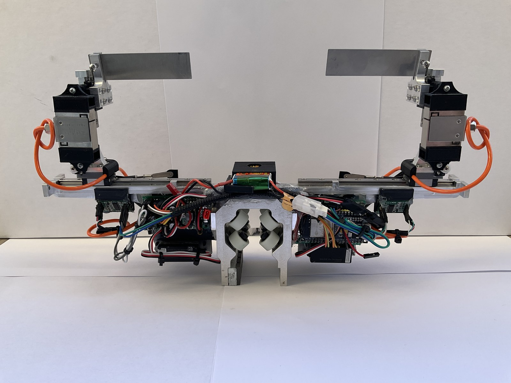
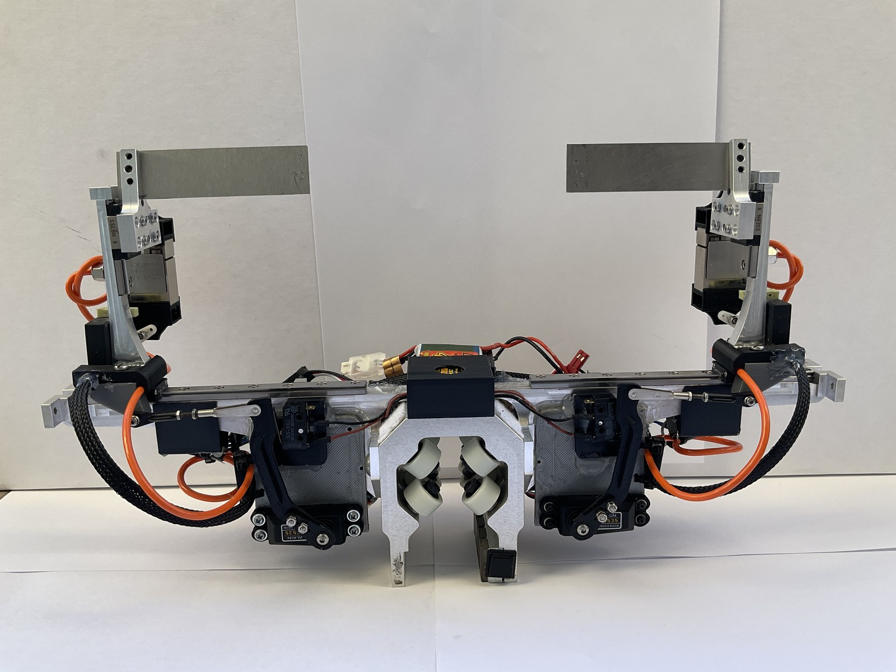
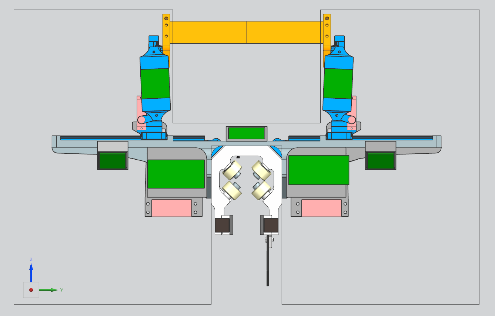
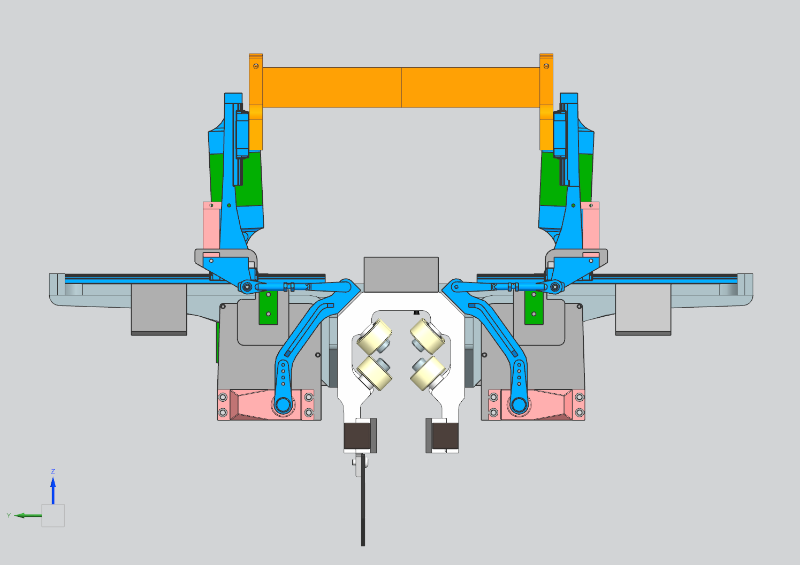
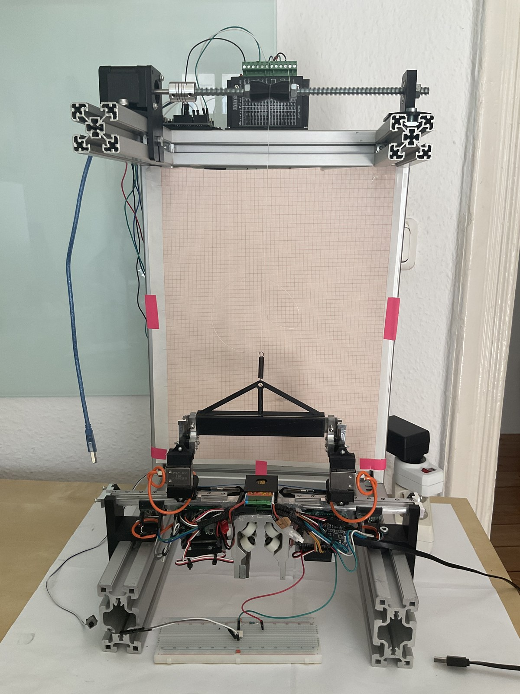

# adaptive-manipulator-bachelor-thesis

Adaptive manipulator developed for my bachelor's thesis, with firmware for control, calibration, and testbench measurements.

## Thesis

[Read the bachelor's thesis (PDF)](docs/FlorianGeissler_BachelorThesis.pdf).

## Manipulator

| Top view | Bottom view |
| --- | --- |
|  |  |
|  |  |

The assembled prototype and the corresponding CAD views.

## Testbench

Testbench used to evaluate the manipulator.
